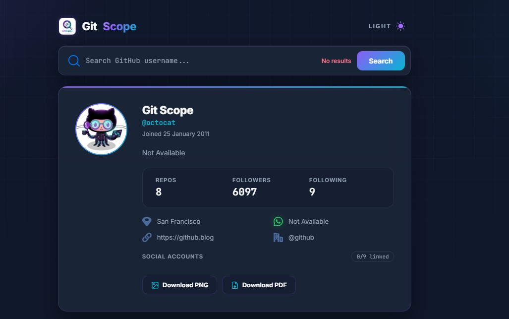
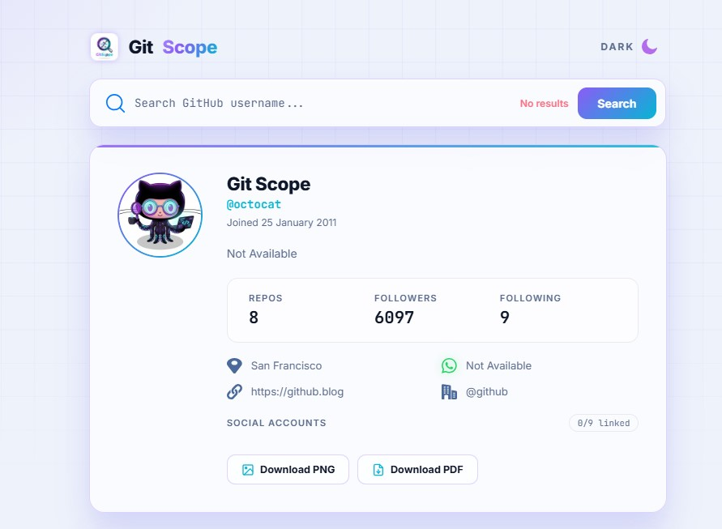
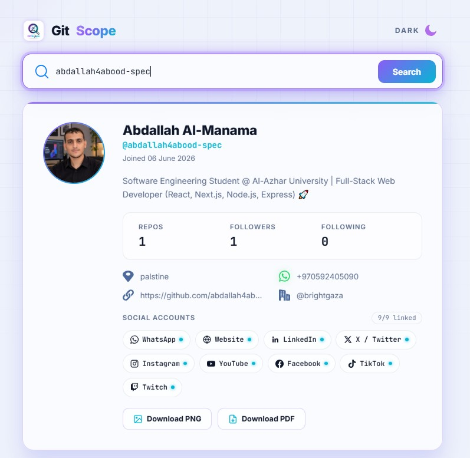
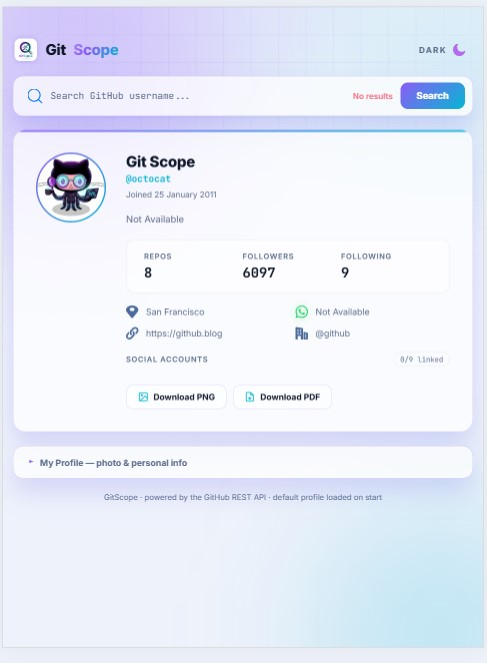
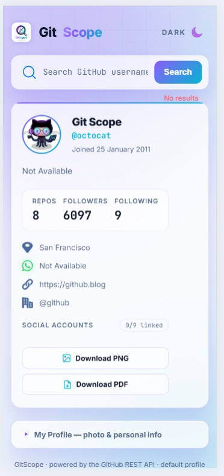
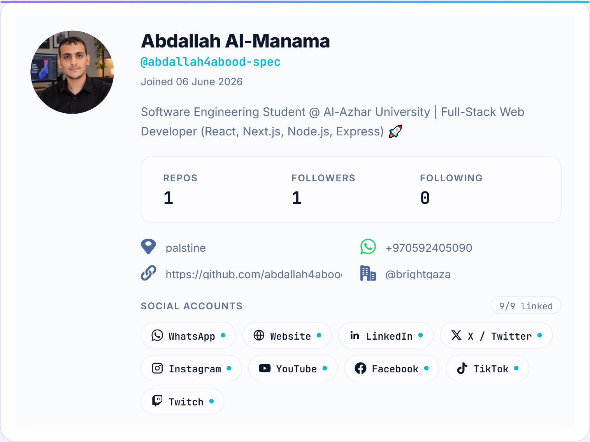

<div align="center">

# 🚀 Git-Scope — Advanced GitHub Profile Explorer

  <p><strong>أداة ويب احترافية وعصرية لاستكشاف وتحليل ملفات مستخدمي GitHub بتصميم Cyber Neon وميزات تصدير متقدمة.</strong></p>

  <p>
    <a href="https://abdallah4abood-spec.github.io/Git-Scope/" target="_blank">🌐 Live Demo</a> •
    <a href="#-features">✨ Features</a> •
    <a href="#-screenshots">📸 Screenshots</a> •
    <a href="#-tech-stack">🛠️ Tech Stack</a> •
    <a href="#-installation--setup">⚙️ Setup</a> •
    <a href="#-author">👤 Author</a>
  </p>

  <!-- Badges -->
  <p>
    
    
    
    
  </p>

</div>

---

## 🎯 Overview

تُعد أداة **Git-Scope** منصة ويب تفاعلية صُممت لتزويد المطورين والباحثين بتجربة استكشاف سلسة وشاملة لبيانات مستخدمي GitHub عبر استهلاك **GitHub REST API**. تم بناء التطبيق بهندسة واجهات حديثة تعتمد على النمط البصري *Cyber Neon / Obsidian Violet*، مع دعم ديناميكي كامل للتحويل بين الوضعين الداكن والفاتح (Dark/Light Mode).

تتيح الأداة استعراض الإحصائيات الدقيقة، أعلى اللغات البرمجية المستعملة في المستودعات العامة، مع إمكانية تصدير بطاقة الملف الشخصي كصورة عالية الدقة **PNG** أو ملف **PDF** دون ظهور أي عناصر تحكم جانبية.

---

## ✨ Features

- **🔍 بحث ذكي مع معالجة الأخطاء:** استعلام فوري ومباشر عن أي حساب مستخدم على GitHub مع تحقق تلقائي للحد من الطلبات الفارغة وإظهار تنبيهات مخصصة عند حدوث أخطاء مثل `404 Not Found` أو تجاوز حد الطلبات `403 Rate Limit`.
- **🎨 واجهة Cyber Neon ديناميكية:** تصميم عصري وجذاب يدعم التنقل السلس بين الوضعين الداكن والفاتح (Dark/Light Mode) مع الحفاظ على التباين البصري وسهولة القراءة.
- **⚡ نظام التخزين المؤقت (Caching System):** حفظ مؤقت لبيانات الحسابات المستعلم عنها في الـ `localStorage` لتسريع سرعة الاستجابة وتفادي استهلاك الحد الأقصى لطلبات GitHub API.
- **📤 تصدير نقي وعالي الدقة (Clean Card Export):** تصدير بطاقة البروفايل مباشرة بصيغة **PNG** أو **PDF** بآلية معالجة ذكية تُخفي أزرار التحكم تلقائياً وتمنع تشويه العناصر أو اقتطاع الحواف أثناء الالتقاط.
- **📱 تصميم متجاوب بالكامل (Fully Responsive):** تجربة استخدام متكاملة ومصممة بدقة لتناسب مختلف الشاشات (الهواتف الذكية، الأجهزة اللوحية، وشاشات سطح المكتب).
- **💫 تفاعلات بصرية و 3D Effects:** تأثيرات حركية أنيقة، تأثير الميلان الثلاثي الأبعاد (3D Tilt Effect)، إشعارات فورية (Toasts)، وحالات تحميل افتراضية (Skeleton Loaders).

---

## 📸 Screenshots & Previews

<div align="center">

### 🖥️ Desktop Views
<p>
  
  
</p>

### ⚡ Active States & Interactive UI


### 📱 Tablet & Mobile Responsive
<p>
  
  
</p>

### 💳 Exported Profile Card Sample (PNG)


</div>

---

## 🛠️ Tech Stack

تم تطوير التطبيق باستخدام تقنيات الويب الأساسية لضمان أقصى درجات السرعة والأداء العالي دون الحاجة إلى أطر عمل ثقيلة:

- **HTML5:** بناء هيكلي سليم معتمد على معايير الوصول (Semantic Markup).
- **Tailwind CSS:** لتنسيق الواجهات، إدارة الثيمات، والتصميم المتجاوب بكفاءة عالية.
- **Vanilla JavaScript (ES6+):** معالجة المنطق البرمجي، إدارة الـ DOM، والتفاعل مع الـ API بنظام Async/Await.
- **Libraries & Utilities:**
  - `html2canvas`: لالتقاط بطاقة المستخدم وتحويل عناصر الـ DOM إلى صور بدقة عالية.
  - `jsPDF`: لتوليد وتحويل الكانفاس إلى مستندات PDF بدقة متناسبة.

---

## ⚙️ Installation & Setup

لتشغيل المشروع محلياً على جهازك، اتبع الخطوات التالية:

1. **استنساخ المستودع (Clone Repository):**
   ```bash
   git clone [https://github.com/abdallah4abood-spec/Git-Scope.git](https://github.com/abdallah4abood-spec/Git-Scope.git)
